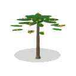
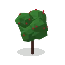
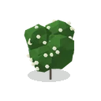
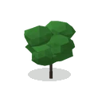
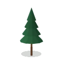
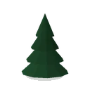
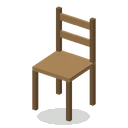

# house-catalog

Data catalog of the [house view](https://github.com/Elwinmage/ha-house-view-component)
for Home Assistant: the trees and the objects it draws around and inside the
house, and the fish of its ponds. Adding a tree species, a piece of furniture
or a fish is a pull request here, not a new release of the integration or of
the card.

| Section | Content | Downloaded by | Shown by |
|---|---|---|---|
| `trees` | trees and shrubs: a simple shape and up to four renderings, one per season | [house_view](https://github.com/Elwinmage/ha-house-view-component) | house-view-card |
| `objects` | furniture and outdoor objects, made of a few simple solids | [house_view](https://github.com/Elwinmage/ha-house-view-component) | house-view-card |
| `pond_fish` | pond fish: a body, its fins and its colour varieties | [house_view](https://github.com/Elwinmage/ha-house-view-component) | house-view-card |

The catalog follows the conventions of
[reeftech-catalog](https://github.com/Elwinmage/reeftech-catalog): one folder
per entry, JSON Schemas, one release per section, and the same release format,
so that the [catalog editor](https://github.com/Elwinmage/catalog-editor) and
the catalog client handle its sections like any other, once declared to them.
See [doc/consumers.md](doc/consumers.md).

Entries are **data only**: no 3D model, no texture. A tree is a few numbers
and colours, an object a list of boxes, cylinders, spheres and cones; the card
draws them itself, in its own style, and a whole section weighs a few
kilobytes. See [doc/format.md](doc/format.md).

## Layout

```
schema/                         JSON schemas (2020-12)
trees/
  items/<tree_id>/
    tree.json                   name, shape, sizes, one rendering per season
    image.webp                  picture (optional): the four seasons
    thumb.webp                  small picture for lists (optional): summer
objects/
  items/<object_id>/
    object.json                 name, category, parts
    image.webp / thumb.webp     pictures (optional)
pond_fish/
  items/<fish_id>/
    pond_fish.json              name, sizes, swimming, colour varieties
    image.webp / thumb.webp     pictures (optional): every variety, the first one
scripts/                        validate.py, make_release.py, render_previews.py,
                                readme_catalog.py, sync_client.py (description and
                                rules into the editor, description and built-in
                                snapshots into the house view)
client/                         what the tools using the catalog get a copy of: its
                                description (repository, sections) and its rules
```

A folder name is the entry id. Ids are **stable**: house views refer to them,
so an entry is never renamed, only removed.

## Trees

```json
{
  "name": { "en": "Cherry tree", "fr": "Cerisier" },
  "latin": "Prunus avium",
  "shape": "round",
  "evergreen": false,
  "height": { "default": 7, "min": 3, "max": 15 },
  "crown_radius": 3,
  "trunk": { "height": 2.2, "radius": 0.2, "color": "#5a3a30" },
  "seasons": {
    "spring": { "foliage": "#a9d47a", "density": 0.75, "flowers": { "color": "#fbf3f5", "amount": 0.85 } },
    "summer": { "foliage": "#3f8a3a", "fruits": { "color": "#c2182b", "amount": 0.35 } },
    "autumn": { "foliage": "#d9642b", "density": 0.75, "fallen": { "color": "#c9652e", "amount": 0.5 } },
    "winter": { "foliage": "#6b4a3c", "density": 0 }
  }
}
```

- `shape`: `round` (a crown of leafy clumps: oak, birch, fruit trees, a
  shrub), `conical` (stacked cones: pine, fir, yew) or `weeping` (a low dome
  with curtains of branches hanging from it: weeping willow) or `palm` (a bare
  trunk and a tuft of fronds: date palm, coconut palm).
- Sizes are in metres, for a tree of the default `height`; the card scales
  the whole tree to the height chosen when it is placed, within `min` and `max`.
- `seasons`: up to four renderings. `summer` is mandatory; a missing season is
  drawn like summer (enough for most evergreens). Each one gives the colour of
  the `foliage`, its `density` (1 fills the crown, 0 leaves bare branches) and
  optional `flowers`, `fruits` and `fallen` leaves or petals, each with a
  colour and an amount. The card blends from one season to the next.
- `varieties`: colours a tree comes in, chosen when it is planted: each has an
  `id`, a `name` and the colour of its `flowers` and/or `fruits` (a red, a
  yellow or a green apple). Without a choice, the colours of `seasons` apply.
- `evergreen`: keeps its foliage in winter. A deciduous tree should give its
  four seasons.
- `keywords`: words naming the tree in a Sweet Home 3D plan, so that a plant of
  the plan is drawn with it.

## Objects

```json
{
  "name": { "en": "Chair", "fr": "Chaise" },
  "category": "seating",
  "parts": [
    { "shape": "box", "width": 0.04, "height": 0.9, "depth": 0.04, "x": -0.19, "z": -0.19, "color": "#8a6a45" },
    { "shape": "box", "width": 0.42, "height": 0.04, "depth": 0.42, "elevation": 0.41, "color": "#b8915f", "tint": true }
  ]
}
```

- An object stands on the ground, **centred on its footprint**, its front
  toward +z; x is the width, y the height, z the depth, in metres.
- `parts`: `box`, `cylinder`, `sphere` or `cone`, each with its three sizes,
  the position of its centre (`x`, `z`), the `elevation` of its bottom and
  optional rotations (`yaw`, `pitch`, `roll`, in degrees).
- `tint`: the part takes the colour chosen for the object when it is placed
  (the colour of a piece of furniture of the plan, for instance).
- The size of an object is the one of its parts; it is not written twice.

## Fish

```json
{
  "name": { "en": "Koi carp", "fr": "Carpe koï" },
  "latin": "Cyprinus rubrofuscus",
  "length": { "default": 0.5, "min": 0.15, "max": 0.9 },
  "body": { "width": 0.2, "height": 0.22, "tail": 0.2, "fins": "short" },
  "swim": { "speed": 0.18, "depth": "middle", "school": false },
  "varieties": [
    { "id": "kohaku", "name": { "en": "Kohaku (red and white)" }, "base": "#f6f2ea",
      "patches": [{ "color": "#d3301f", "amount": 0.45, "size": "large", "where": "back" }] },
    { "id": "yamabuki-ogon", "name": { "en": "Yamabuki ogon (gold yellow)" }, "base": "#f0bf2c", "metallic": true }
  ]
}
```

- The card draws the fish itself, mostly seen from above: `body` sizes are
  shares of the `length` (metres, snout to tail).
- `varieties`: the colour of the body (`base`), optionally of the flanks
  (`belly`) and of the fins, `metallic` scales, and `patches` (colour, share
  of the back covered, size, place). Each fish of a pond gets a robe of its
  own from its variety; a pond can also give colours of its own.
- `swim`: cruising speed, the depth kept in warm water, schooling.

## Pictures

`scripts/render_previews.py` draws `image.webp` and `thumb.webp` from the
descriptor, with the same reading of the format as the card: the picture of a
tree shows its four seasons (spring, summer / autumn, winter), the one of a
fish every variety, seen from above. A photo or a
drawing of your own may replace them.

## Catalog content

<!-- catalog:begin -->
<!-- Generated by scripts/readme_catalog.py: do not edit by hand -->

<details>
<summary><b>Trees</b> (16)</summary>

|  | Id | Tree | Botanical name | Shape | Foliage | Height | Seasons | Varieties |
|---|---|---|---|---|---|---|---|---|
|  | `apple-tree` | Apple tree | <i>Malus domestica</i> | round | deciduous | 5 m (2.5-9) | spring, summer, autumn, winter | gala, golden-delicious, granny-smith, reinette-grise |
|  | `apricot-tree` | Apricot tree | <i>Prunus armeniaca</i> | round | deciduous | 4.5 m (2-8) | spring, summer, autumn, winter |  |
|  | `canary-palm` | Canary Island date palm | <i>Phoenix canariensis</i> | palm | evergreen | 9 m (3-20) | spring, summer, autumn, winter |  |
|  | `cherry-tree` | Cherry tree | <i>Prunus avium</i> | round | deciduous | 7 m (3-15) | spring, summer, autumn, winter |  |
|  | `coconut-palm` | Coconut palm | <i>Cocos nucifera</i> | palm | evergreen | 13 m (4-28) | spring, summer, autumn, winter |  |
|  | `date-palm` | Date palm | <i>Phoenix dactylifera</i> | palm | evergreen | 12 m (4-25) | spring, summer, autumn, winter |  |
|  | `elder` | Black elder | <i>Sambucus nigra</i> | round | deciduous | 4 m (2-7) | spring, summer, autumn, winter |  |
|  | `eucalyptus` | Eucalyptus | <i>Eucalyptus globulus</i> | round | evergreen | 14 m (6-30) | summer |  |
|  | `japanese-cherry` | Japanese flowering cherry | <i>Prunus serrulata</i> | round | deciduous | 6 m (3-10) | spring, summer, autumn, winter | kanzan, yoshino, shirotae |
|  | `norway-spruce` | Norway spruce | <i>Picea abies</i> | conical | evergreen | 14 m (4-35) | spring, summer, autumn, winter |  |
|  | `oak` | Oak | <i>Quercus robur</i> | round | deciduous | 9 m (4-25) | spring, summer, autumn, winter |  |
|  | `pear-tree` | Pear tree | <i>Pyrus communis</i> | round | deciduous | 6 m (3-12) | spring, summer, autumn, winter | williams, conference, passe-crassane |
|  | `pine` | Pine | <i>Pinus sylvestris</i> | conical | evergreen | 10 m (3-25) | spring, summer, autumn, winter |  |
|  | `silver-fir` | Silver fir | <i>Abies alba</i> | conical | evergreen | 16 m (4-40) | spring, summer, autumn, winter |  |
|  | `weeping-willow` | Weeping willow | <i>Salix babylonica</i> | weeping | deciduous | 10 m (5-18) | spring, summer, autumn, winter |  |
|  | `yew` | Yew | <i>Taxus baccata</i> | conical | evergreen | 6 m (1.5-15) | spring, summer, autumn, winter |  |

</details>

<details>
<summary><b>Objects</b> (1)</summary>

|  | Id | Object | Category | Width x depth x height | Parts |
|---|---|---|---|---|---|
|  | `chair` | Chair | seating | 0.42 x 0.42 x 0.9 m | 7 |

</details>

<details>
<summary><b>Fish</b> (1)</summary>

|  | Id | Fish | Scientific name | Length | Varieties |
|---|---|---|---|---|---|
|  | `koi` | Koi carp | <i>Cyprinus rubrofuscus</i> | 0.5 m (0.15-0.9) | kohaku, sanke, showa, tancho, benigoi, yamabuki-ogon, platinum-ogon, kigoi, chagoi, asagi, karasugoi |

</details>

<!-- catalog:end -->

## Development

```
pip install -r requirements.txt
pre-commit install                       # same checks as the CI, before each commit
python scripts/validate.py               # schemas and rules
python scripts/render_previews.py        # pictures of the entries that have none
pytest --cov=scripts --cov=client --cov-fail-under=100
```

## License

Catalog data and pictures: CC BY 4.0. Scripts and schemas: MIT. See
[LICENSE.md](LICENSE.md).
