# house-catalog

Data catalog of the [house view](https://github.com/Elwinmage/ha-house-view-component)
for Home Assistant: the trees and the objects it draws around and inside the
house, the fish of its ponds, what its paths, its terraces and its low walls
are made of and capped with, and its kinds of fences. Adding a tree species, a
piece of furniture, a fish, a kind of path, a terrace surface, a wall facing, a
coping or a fence is a pull request here, not a new release of the integration or of the card.

| Section | Content | Downloaded by | Shown by |
|---|---|---|---|
| `trees` | trees and shrubs: a simple shape and up to four renderings, one per season | [house_view](https://github.com/Elwinmage/ha-house-view-component) | house-view-card |
| `objects` | furniture and outdoor objects, made of a few simple solids | [house_view](https://github.com/Elwinmage/ha-house-view-component) | house-view-card |
| `pond_fish` | pond fish: a body, its fins and its colour varieties | [house_view](https://github.com/Elwinmage/ha-house-view-component) | house-view-card |
| `paths` | what a drive or a garden path is made of: a surface, or modules set one after another | [house_view](https://github.com/Elwinmage/ha-house-view-component) | house-view-card |
| `terraces` | what a terrace, a patio or a deck is covered with: decking, tiles, stone, concrete | [house_view](https://github.com/Elwinmage/ha-house-view-component) | house-view-card |
| `walls` | what a low wall or a retaining wall is faced with: render, stone, brick, and its coping | [house_view](https://github.com/Elwinmage/ha-house-view-component) | house-view-card |
| `copings` | what caps a low wall, whatever it is faced with: stone slabs, bricks on edge, tiles, a folded metal sheet | [house_view](https://github.com/Elwinmage/ha-house-view-component) | house-view-card |
| `fences` | kinds of fences: height, thickness, posts, see-through or solid, hedges | [house_view](https://github.com/Elwinmage/ha-house-view-component) | house-view-card |

The catalog follows the conventions of
[reeftech-catalog](https://github.com/Elwinmage/reeftech-catalog): one folder
per entry, JSON Schemas, one release per section, and the same release format,
so that the [catalog editor](https://github.com/Elwinmage/catalog-editor) and
the catalog client handle its sections like any other, once declared to them.
See [doc/consumers.md](doc/consumers.md).

Entries are **data only**: no 3D model, no texture. A tree is a few numbers
and colours, an object a list of boxes, cylinders, spheres and cones; the card
draws them itself, in its own style, and a whole section weighs a few
kilobytes. See [doc/format.md](doc/format.md).

## Layout

```
schema/                         JSON schemas (2020-12)
trees/
  items/<tree_id>/
    tree.json                   name, shape, sizes, one rendering per season
    image.webp                  picture (optional): the four seasons
    thumb.webp                  small picture for lists (optional): summer
objects/
  items/<object_id>/
    object.json                 name, category, parts
    image.webp / thumb.webp     pictures (optional)
pond_fish/
  items/<fish_id>/
    pond_fish.json              name, sizes, swimming, colour varieties
    image.webp / thumb.webp     pictures (optional): every variety, the first one
paths/
  items/<path_id>/
    path.json                   name, kind, width, surface or modules
    image.webp / thumb.webp     pictures (optional): a piece of path from above
terraces/
  items/<terrace_id>/
    terrace.json                name, thickness, surface
    image.webp / thumb.webp     pictures (optional): a square of terrace from above
walls/
  items/<wall_id>/
    wall.json                   name, surface of the faces, coping
    image.webp / thumb.webp     pictures (optional): a piece of wall from the front
copings/
  items/<coping_id>/
    coping.json                 name, surface, height, overhang, folded edges
    image.webp / thumb.webp     pictures (optional): the capped top of a wall from the front
fences/
  items/<fence_id>/
    fence.json                  name, height, thickness, surface, wires, posts
    image.webp / thumb.webp     pictures (optional): a run of fence from the front
scripts/                        validate.py, make_release.py, render_previews.py,
                                readme_catalog.py, sync_client.py (description and
                                rules into the editor, description and built-in
                                snapshots into the house view)
client/                         what the tools using the catalog get a copy of: its
                                description (repository, sections) and its rules
```

A folder name is the entry id. Ids are **stable**: house views refer to them,
so an entry is never renamed, only removed.

## Trees

```json
{
  "name": { "en": "Cherry tree", "fr": "Cerisier" },
  "latin": "Prunus avium",
  "shape": "round",
  "evergreen": false,
  "height": { "default": 7, "min": 3, "max": 15 },
  "crown_radius": 3,
  "trunk": { "height": 2.2, "radius": 0.2, "color": "#5a3a30" },
  "seasons": {
    "spring": { "foliage": "#a9d47a", "density": 0.75, "flowers": { "color": "#fbf3f5", "amount": 0.85 } },
    "summer": { "foliage": "#3f8a3a", "fruits": { "color": "#c2182b", "amount": 0.35 } },
    "autumn": { "foliage": "#d9642b", "density": 0.75, "fallen": { "color": "#c9652e", "amount": 0.5 } },
    "winter": { "foliage": "#6b4a3c", "density": 0 }
  }
}
```

- `shape`: `round` (a crown of leafy clumps: oak, birch, fruit trees, a
  shrub), `conical` (stacked cones, tapering all the way down: spruce, fir),
  `columnar` (a column of foliage down to the ground, rounded off at the top:
  yew, cypress, thuja), `weeping` (a low dome with curtains of branches hanging
  from it: weeping willow) or `palm` (a bare trunk and a tuft of fronds: date
  palm, coconut palm).
- Sizes are in metres, for a tree of the default `height`; the card scales
  the whole tree to the height chosen when it is placed, within `min` and `max`.
- `seasons`: up to four renderings. `summer` is mandatory; a missing season is
  drawn like summer (enough for most evergreens). Each one gives the colour of
  the `foliage`, its `density` (1 fills the crown, 0 leaves bare branches) and
  optional `flowers`, `fruits` and `fallen` leaves or petals, each with a
  colour and an amount. The card blends from one season to the next.
- `varieties`: colours a tree comes in, chosen when it is planted: each has an
  `id`, a `name` and the colour of its `flowers` and/or `fruits` (a red, a
  yellow or a green apple). Without a choice, the colours of `seasons` apply.
- `evergreen`: keeps its foliage in winter. A deciduous tree should give its
  four seasons.
- `keywords`: words naming the tree in a Sweet Home 3D plan, so that a plant of
  the plan is drawn with it.

## Objects

```json
{
  "name": { "en": "Chair", "fr": "Chaise" },
  "category": "seating",
  "parts": [
    { "shape": "box", "width": 0.04, "height": 0.9, "depth": 0.04, "x": -0.19, "z": -0.19, "color": "#8a6a45" },
    { "shape": "box", "width": 0.42, "height": 0.04, "depth": 0.42, "elevation": 0.41, "color": "#b8915f", "tint": true }
  ]
}
```

- An object stands on the ground, **centred on its footprint**, its front
  toward +z; x is the width, y the height, z the depth, in metres.
- `parts`: `box`, `cylinder`, `sphere` or `cone`, each with its three sizes,
  the position of its centre (`x`, `z`), the `elevation` of its bottom and
  optional rotations (`yaw`, `pitch`, `roll`, in degrees).
- `tint`: the part takes the colour chosen for the object when it is placed
  (the colour of a piece of furniture of the plan, for instance).
- The size of an object is the one of its parts; it is not written twice.

## Fish

```json
{
  "name": { "en": "Koi carp", "fr": "Carpe koï" },
  "latin": "Cyprinus rubrofuscus",
  "length": { "default": 0.5, "min": 0.15, "max": 0.9 },
  "body": { "width": 0.2, "height": 0.22, "tail": 0.2, "fins": "short" },
  "swim": { "speed": 0.18, "depth": "middle", "school": false },
  "varieties": [
    { "id": "kohaku", "name": { "en": "Kohaku (red and white)" }, "base": "#f6f2ea",
      "patches": [{ "color": "#d3301f", "amount": 0.45, "size": "large", "where": "back" }] },
    { "id": "yamabuki-ogon", "name": { "en": "Yamabuki ogon (gold yellow)" }, "base": "#f0bf2c", "metallic": true }
  ]
}
```

- The card draws the fish itself, mostly seen from above: `body` sizes are
  shares of the `length` (metres, snout to tail).
- `varieties`: the colour of the body (`base`), optionally of the flanks
  (`belly`) and of the fins, `metallic` scales, and `patches` (colour, share
  of the back covered, size, place). Each fish of a pond gets a robe of its
  own from its variety; a pond can also give colours of its own.
- `swim`: cruising speed, the depth kept in warm water, schooling.

## Paths

```json
{
  "name": { "en": "Stepping stones", "fr": "Pas japonais" },
  "kind": "module",
  "draft": "#b5b0a6",
  "width": { "default": 0.5, "min": 0.3, "max": 1.2 },
  "module": {
    "shapes": ["round", "half-moon"],
    "size": [0.45, 0.45], "thickness": 0.05, "gap": 0.25,
    "colors": ["#8d8a84", "#a39a8c", "#6f7a72"],
    "vary": { "size": 0.25, "angle": 0.5, "side": 0.15, "shade": 0.12 }
  }
}
```

- A path is laid along a centre line and is `width` metres wide; `draft` is
  the colour it is drawn in on the overlay of the editor.
- `kind: surface` is an unbroken strip. Its texture is painted from numbers
  alone -- base colour, `grain`, `speckles` (coloured grains, `stretch` turning
  a pebble into a chip of bark or a shard of slate), `joints` (the units of a
  laid surface: pavers, slabs, boards) and `wheels` (two ruts worn across a
  grass track) -- so a surface added here needs no line of code in the card.
- `kind: module` sets elements one after another, the ground showing between
  them: `shapes` (`round`, `half-moon`, `slab`, `oval`, `stone`), `size` along
  then across, `thickness`, `gap`, and the `colors` they are taken from.
  `vary` is how much they differ from one another, so no two are quite alike.
- Stepping stones, landscape sleepers and log rounds are the same `module`
  family under different numbers: a sleeper is a long `slab`, a log round a
  thick `round`.

## Terraces, walls, copings and fences

```json
{
  "name": { "en": "Dry stone", "fr": "Pierre sèche" },
  "draft": "#c7b99b",
  "surface": {
    "color": "#9c9382", "roughness": 1, "tile": 2.24, "grain": 0.3,
    "joints": { "color": "#4d483f", "cell": [0.14, 0.34], "width": 0.012, "stagger": 0.5, "shade": 0.22, "vary": 0.5 }
  }
}
```

These sections share one `surface`: the painted texture of a path
`surface`, without the wheel ruts, and with `vary` in its `joints` for units
of uneven length (the stones of a coursed rubble wall). With
`"pattern": "irregular"` the joints have no rows at all: stones of uneven
shapes and sizes fitted into one another, some of them in other `tints`, each
one bulging by its `relief` (a wall of stones as they came, a crazy paving).
`draft` is the colour of the entry on the overlay of the editor.

- A **terrace** (`terraces`) is laid flat over the outline the user draws, the
  ground levelled under it: `thickness` is how far it stands over that ground,
  and the rows of the `surface` run across the laying direction the user gives
  it, so the boards of a deck follow that direction.
- A **wall** (`walls`) is the facing of a low wall or of a retaining wall. The
  `surface` is seen on its upright faces, a row being a course: `cell` gives
  the height of a stone first, then its length. `coping` caps it (`color`,
  `height`, `overhang`).
- A **coping** (`copings`) is what the user caps a wall with in place of the
  capping of its facing, or on a facing that has none: `surface`, `height`
  above the top of the wall, `overhang` on each side and `drop`, how far its
  edges come down over the faces (a folded metal sheet). A row of its
  `surface` runs along the wall: `cell` gives the depth of a row across the
  wall first -- deeper than the coping is wide for one unit across, a brick on
  edge or a slab --, then the length of a unit along the wall. It has no
  `draft`: it is not drawn on the overlay.
- A **fence** (`fences`) is a kind of fence, one per side of a property:
  `height` (the usual one and the bounds offered), `thickness` (0 for a
  sheet), `surface`, and `posts` (`color`, `spacing`, `size`). `open` makes it
  see-through -- `pattern` `mesh` (wire netting in diamonds), `grid` (welded
  panel) or `bars` (bars between two rails), `pitch` between two wires and
  `fill`, the share of the sheet they cover -- and `foliage` makes it a
  hedge, with an uneven top. The `draft` colours of the fences all differ:
  they tell the sides of a fence apart while it is edited.

## Pictures

`scripts/render_previews.py` draws `image.webp` and `thumb.webp` from the
descriptor, with the same reading of the format as the card: the picture of a
tree shows its four seasons (spring, summer / autumn, winter), the one of a
fish every variety, seen from above, and the one of a path a piece of it seen
from straight above, at its real scale. A terrace is a square of it seen from
above, a wall a piece of it seen from the front with its coping, and a fence a
run of it at its usual height, with its posts. A photo or a drawing of your
own may replace them.

## Catalog content

<!-- catalog:begin -->
<!-- Generated by scripts/readme_catalog.py: do not edit by hand -->

<details>
<summary><b>Trees</b> (110)</summary>

|  | Tree | Botanical name | Shape | Foliage | Height | Seasons |
|---|---|---|---|---|---|---|
| 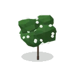 | Hardy kiwi<br>`actinidia-arguta` | <i>Actinidia arguta 'Issai'</i> | round | deciduous | 5 m (2.25-8) | 4 seasons |
| 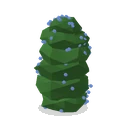 | Blue agapanthus<br>`agapanthus-columba` | <i>Agapanthus 'Columba'</i> | columnar | deciduous | 0.7 m (0.32-1.12) | 4 seasons |
| 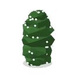 | White agapanthus<br>`agapanthus-glacier-stream` | <i>Agapanthus 'Glacier Stream'</i> | columnar | deciduous | 0.9 m (0.41-1.44) | 4 seasons |
| 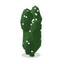 | Naples garlic<br>`allium-neapolitanum` | <i>Allium neapolitanum</i> | round | deciduous | 0.4 m (0.18-0.64) | 4 seasons |
| 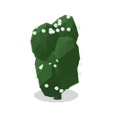 | Chives 'Corsican White'<br>`allium-schoenoprasum-corsican-white` | <i>Allium schoenoprasum 'Corsican White'</i> | round | deciduous | 0.3 m (0.14-0.48) | 4 seasons |
| 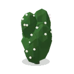 | Marshmallow<br>`althaea-officinalis` | <i>Althaea officinalis</i> | round | deciduous | 1.5 m (0.68-2.4) | 4 seasons |
| 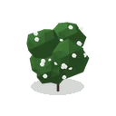 | Snowy mespilus<br>`amelanchier-ovalis` | <i>Amelanchier ovalis</i> | round | deciduous | 3 m (1.35-4.8) | 4 seasons |
| 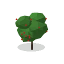 | Apple tree<br>`apple-tree` | <i>Malus domestica</i> | round | deciduous | 5 m (2.5-9) | 4 seasons |
| 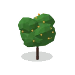 | Apricot tree<br>`apricot-tree` | <i>Prunus armeniaca</i> | round | deciduous | 4.5 m (2-8) | 4 seasons |
| 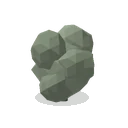 | Southernwood<br>`artemisia-abrotanum` | <i>Artemisia abrotanum</i> | round | evergreen | 1 m (0.45-1.6) | 4 seasons |
| 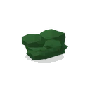 | Aubretia 'Mésange Bleue'<br>`aubrieta-mesange-bleue` | <i>Aubrieta 'Mésange Bleue'</i> | round | evergreen | 0.15 m (0.1-0.24) | 4 seasons |
| 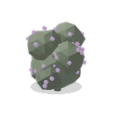 | False dittany<br>`ballota-pseudodictamnus` | <i>Ballota pseudodictamnus</i> | round | evergreen | 0.6 m (0.27-0.96) | 4 seasons |
| 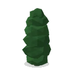 | Perennial kale<br>`brassica-oleracea-daubenton` | <i>Brassica oleracea var. ramosa</i> | columnar | evergreen | 0.9 m (0.41-1.44) | 4 seasons |
| 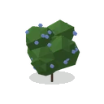 | Butterfly bush 'Nanho Blue'<br>`buddleja-davidii-nanho-blue` | <i>Buddleja davidii 'Nanho Blue'</i> | round | deciduous | 1.5 m (0.68-2.4) | 4 seasons |
| 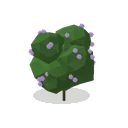 | Butterfly bush 'Lochinch'<br>`buddleja-lochinch` | <i>Buddleja x fallowiana 'Lochinch'</i> | round | deciduous | 3 m (1.35-4.8) | 4 seasons |
| 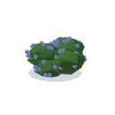 | Dalmatian bellflower<br>`campanula-portenschlagiana` | <i>Campanula portenschlagiana</i> | round | deciduous | 0.15 m (0.1-0.24) | 4 seasons |
|  | Canary Island date palm<br>`canary-palm` | <i>Phoenix canariensis</i> | palm | evergreen | 9 m (3-20) | 4 seasons |
| 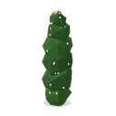 | Giant scabious<br>`cephalaria-gigantea` | <i>Cephalaria gigantea</i> | columnar | deciduous | 2 m (0.9-3.2) | 4 seasons |
| 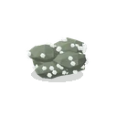 | Snow-in-summer<br>`cerastium-tomentosum` | <i>Cerastium tomentosum</i> | round | evergreen | 0.15 m (0.1-0.24) | 4 seasons |
|  | Cherry tree<br>`cherry-tree` | <i>Prunus avium</i> | round | deciduous | 7 m (3-15) | 4 seasons |
| 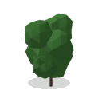 | Wintersweet<br>`chimonanthus-praecox` | <i>Chimonanthus praecox</i> | round | deciduous | 2.5 m (1.12-4) | 4 seasons |
| 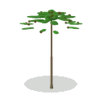 | Coconut palm<br>`coconut-palm` | <i>Cocos nucifera</i> | palm | evergreen | 13 m (4-28) | 4 seasons |
| 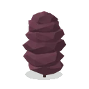 | Purple filbert<br>`corylus-maxima-purpurea` | <i>Corylus maxima 'Purpurea'</i> | columnar | deciduous | 5 m (2.25-8) | 4 seasons |
| 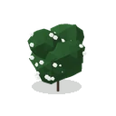 | Milkflower cotoneaster<br>`cotoneaster-lacteus` | <i>Cotoneaster lacteus</i> | round | evergreen | 3 m (1.35-4.8) | 4 seasons |
| 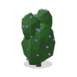 | Globe artichoke<br>`cynara-scolymus` | <i>Cynara scolymus</i> | round | deciduous | 1.5 m (0.68-2.4) | 4 seasons |
| 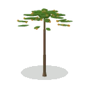 | Date palm<br>`date-palm` | <i>Phoenix dactylifera</i> | palm | evergreen | 12 m (4-25) | 4 seasons |
| 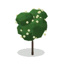 | Persimmon<br>`diospyros-kaki` | <i>Diospyros kaki 'Nikita's Gift'</i> | round | deciduous | 5 m (2.25-8) | 4 seasons |
| 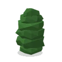 | Male fern<br>`dryopteris-filix-mas` | <i>Dryopteris filix-mas</i> | columnar | deciduous | 1 m (0.45-1.6) | 4 seasons |
| 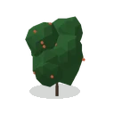 | Ebbing's silverberry<br>`elaeagnus-ebbingei` | <i>Elaeagnus x ebbingei</i> | round | evergreen | 3 m (1.35-4.8) | 4 seasons |
|  | Black elder<br>`elder` | <i>Sambucus nigra</i> | round | deciduous | 4 m (2-7) | 4 seasons |
| 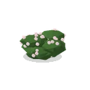 | Mexican fleabane<br>`erigeron-karvinskianus` | <i>Erigeron karvinskianus</i> | round | deciduous | 0.2 m (0.1-0.32) | 4 seasons |
| 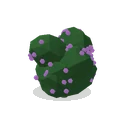 | Perennial wallflower 'Bowles Mauve'<br>`erysimum-bowles-mauve` | <i>Erysimum 'Bowles Mauve'</i> | round | evergreen | 0.9 m (0.41-1.44) | 4 seasons |
|  | Eucalyptus<br>`eucalyptus` | <i>Eucalyptus globulus</i> | round | evergreen | 14 m (6-30) | summer |
| 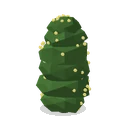 | Fennel<br>`foeniculum-vulgare` | <i>Foeniculum vulgare</i> | columnar | deciduous | 1.5 m (0.68-2.4) | 4 seasons |
| 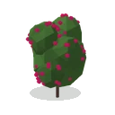 | Hardy climbing fuchsia<br>`fuchsia-regia-reitzii` | <i>Fuchsia regia subsp. reitzii</i> | round | deciduous | 1.25 m (0.56-2) | 4 seasons |
| 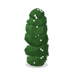 | White gaura 'Blanche'<br>`gaura-lindheimeri-blanche` | <i>Gaura lindheimeri 'Blanche'</i> | columnar | deciduous | 1.2 m (0.54-1.92) | 4 seasons |
| 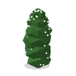 | White gaura 'Brise Fraîche'<br>`gaura-lindheimeri-brise-fraiche` | <i>Gaura lindheimeri 'Brise Fraîche'</i> | columnar | deciduous | 0.9 m (0.41-1.44) | 4 seasons |
| 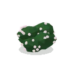 | Bigroot geranium 'Spessart'<br>`geranium-macrorrhizum-spessart` | <i>Geranium macrorrhizum 'Spessart'</i> | round | evergreen | 0.3 m (0.14-0.48) | 4 seasons |
| 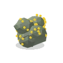 | Curry plant<br>`helichrysum-italicum` | <i>Helichrysum italicum 'Miel & Curry'</i> | round | evergreen | 0.5 m (0.23-0.8) | 4 seasons |
| 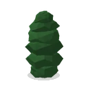 | Stinking hellebore<br>`helleborus-foetidus` | <i>Helleborus foetidus</i> | columnar | evergreen | 0.8 m (0.36-1.28) | 4 seasons |
| 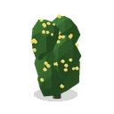 | Citron daylily<br>`hemerocallis-citrina` | <i>Hemerocallis citrina</i> | round | deciduous | 0.9 m (0.41-1.44) | 4 seasons |
| 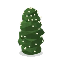 | Daylily 'Gentle Shepherd'<br>`hemerocallis-gentle-shepherd` | <i>Hemerocallis 'Gentle Shepherd'</i> | columnar | deciduous | 0.8 m (0.36-1.28) | 4 seasons |
| 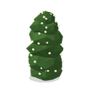 | Daylily 'White Temptation'<br>`hemerocallis-white-temptation` | <i>Hemerocallis 'White Temptation'</i> | columnar | deciduous | 0.8 m (0.36-1.28) | 4 seasons |
| 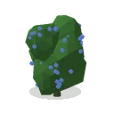 | Hyssop<br>`hyssopus-officinalis` | <i>Hyssopus officinalis</i> | round | deciduous | 0.6 m (0.27-0.96) | 4 seasons |
|  | Japanese flowering cherry<br>`japanese-cherry` | <i>Prunus serrulata</i> | round | deciduous | 6 m (3-10) | 4 seasons |
| 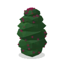 | Macedonian scabious<br>`knautia-macedonica-mars-midget` | <i>Knautia macedonica 'Mars Midget'</i> | columnar | evergreen | 0.7 m (0.32-1.12) | 4 seasons |
| 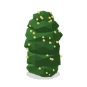 | Lovage<br>`levisticum-officinale` | <i>Levisticum officinale</i> | columnar | deciduous | 1.5 m (0.68-2.4) | 4 seasons |
| 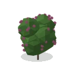 | Pheasant berry<br>`leycesteria-formosa` | <i>Leycesteria formosa</i> | round | deciduous | 2 m (0.9-3.2) | 4 seasons |
| 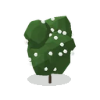 | Border privet 'Ilvomassi'<br>`ligustrum-obtusifolium-ilvomassi` | <i>Ligustrum obtusifolium 'Ilvomassi'</i> | round | deciduous | 1.5 m (0.68-2.4) | 4 seasons |
| 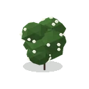 | Wild privet<br>`ligustrum-vulgare` | <i>Ligustrum vulgare</i> | round | deciduous | 3 m (1.35-4.8) | 4 seasons |
| 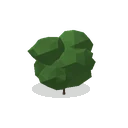 | Winter honeysuckle<br>`lonicera-fragrantissima` | <i>Lonicera fragrantissima</i> | round | deciduous | 2.5 m (1.12-4) | 4 seasons |
| 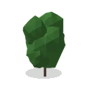 | Honeyberry<br>`lonicera-kamtschatica` | <i>Lonicera kamtschatica</i> | round | deciduous | 1.3 m (0.59-2.08) | 4 seasons |
| 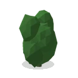 | Lemon balm<br>`melissa-officinalis` | <i>Melissa officinalis</i> | round | deciduous | 0.8 m (0.36-1.28) | 4 seasons |
| 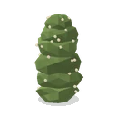 | Zebra grass<br>`miscanthus-sinensis-zebrinus` | <i>Miscanthus sinensis 'Zebrinus'</i> | columnar | deciduous | 1.6 m (0.72-2.56) | 4 seasons |
| 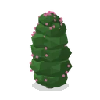 | Bergamot 'Beauty of Cobham'<br>`monarda-beauty-of-cobham` | <i>Monarda fistulosa 'Beauty of Cobham'</i> | columnar | deciduous | 0.9 m (0.41-1.44) | 4 seasons |
|  | Bergamot 'Gardenview Scarlet'<br>`monarda-gardenview-scarlet` | <i>Monarda fistulosa 'Gardenview Scarlet'</i> | round | deciduous | 0.8 m (0.36-1.28) | 4 seasons |
|  | Japanese banana<br>`musa-basjoo` | <i>Musa basjoo 'Dajiao'</i> | palm | evergreen | 3 m (1.35-4.8) | 4 seasons |
|  | Common myrtle<br>`myrtus-communis` | <i>Myrtus communis</i> | round | evergreen | 2 m (0.9-3.2) | 4 seasons |
|  | Variegated myrtle<br>`myrtus-communis-variegata` | <i>Myrtus communis 'Variegata'</i> | round | evergreen | 1.5 m (0.68-2.4) | 4 seasons |
|  | Japanese catmint<br>`nepeta-subsessilis` | <i>Nepeta subsessilis</i> | columnar | deciduous | 1.2 m (0.54-1.92) | 4 seasons |
|  | Norway spruce<br>`norway-spruce` | <i>Picea abies</i> | conical | evergreen | 14 m (4-35) | 4 seasons |
|  | Oak<br>`oak` | <i>Quercus robur</i> | round | deciduous | 9 m (4-25) | 4 seasons |
|  | Olive tree<br>`olive` | <i>Olea europaea</i> | round | evergreen | 5 m (2-12) | 4 seasons |
|  | Oregano<br>`origanum-vulgare` | <i>Origanum vulgare</i> | round | deciduous | 0.4 m (0.18-0.64) | 4 seasons |
|  | Burkwood osmanthus<br>`osmanthus-burkwoodii` | <i>Osmanthus x burkwoodii</i> | round | evergreen | 3 m (1.35-4.8) | 4 seasons |
|  | Switch grass 'Cloud Nine'<br>`panicum-virgatum-cloud-nine` | <i>Panicum virgatum 'Cloud Nine'</i> | columnar | deciduous | 2 m (0.9-3.2) | 4 seasons |
|  | Switch grass 'Dallas Blues'<br>`panicum-virgatum-dallas-blues` | <i>Panicum virgatum 'Dallas Blues'</i> | columnar | deciduous | 1.7 m (0.77-2.72) | 4 seasons |
|  | Pear tree<br>`pear-tree` | <i>Pyrus communis</i> | round | deciduous | 6 m (3-12) | 4 seasons |
|  | Sweet mock orange<br>`philadelphus-coronarius` | <i>Philadelphus coronarius</i> | round | deciduous | 2.5 m (1.12-4) | 4 seasons |
|  | Mock orange 'Pearls of Perfume'<br>`philadelphus-pearls-of-perfume` | <i>Philadelphus 'Pearls of Perfume'</i> | columnar | deciduous | 1.2 m (0.54-1.92) | 4 seasons |
|  | Turkish sage<br>`phlomis-russeliana` | <i>Phlomis russeliana</i> | round | deciduous | 0.9 m (0.41-1.44) | 4 seasons |
|  | Scots pine<br>`pine` | <i>Pinus sylvestris</i> | round | evergreen | 10 m (3-25) | 4 seasons |
|  | Mastic tree<br>`pistacia-lentiscus` | <i>Pistacia lentiscus</i> | round | evergreen | 2 m (0.9-3.2) | 4 seasons |
|  | Chinese pittosporum<br>`pittosporum-heterophyllum` | <i>Pittosporum heterophyllum</i> | round | evergreen | 2.5 m (1.12-4) | 4 seasons |
|  | Purple-leaf plum<br>`prunus-cerasifera-pissardii` | <i>Prunus cerasifera 'Pissardii'</i> | round | deciduous | 7 m (3.15-11.2) | 4 seasons |
|  | Mirabelle plum<br>`prunus-domestica-mirabelle` | <i>Prunus domestica 'Mirabelle de Nancy'</i> | round | deciduous | 6 m (2.7-9.6) | 4 seasons |
|  | Cherry laurel 'Otto Luyken'<br>`prunus-laurocerasus-otto-luyken` | <i>Prunus laurocerasus 'Otto Luyken'</i> | round | evergreen | 1.5 m (0.68-2.4) | 4 seasons |
|  | Rhubarb 'Victoria'<br>`rheum-rhabarbarum-victoria` | <i>Rheum rhabarbarum 'Victoria'</i> | round | deciduous | 0.6 m (0.27-0.96) | 4 seasons |
|  | Blackcurrant<br>`ribes-nigrum` | <i>Ribes nigrum</i> | round | deciduous | 1.5 m (0.68-2.4) | 4 seasons |
|  | Redcurrant<br>`ribes-rubrum` | <i>Ribes rubrum</i> | round | deciduous | 1.5 m (0.68-2.4) | 4 seasons |
|  | Gooseberry<br>`ribes-uva-crispa` | <i>Ribes uva-crispa</i> | round | deciduous | 1 m (0.45-1.6) | 4 seasons |
|  | Dog rose<br>`rosa-canina` | <i>Rosa canina</i> | round | deciduous | 3 m (1.35-4.8) | 4 seasons |
|  | Damask rose<br>`rosa-damascena-trigintipetala` | <i>Rosa x damascena 'Trigintipetala'</i> | round | deciduous | 1.8 m (0.81-2.88) | 4 seasons |
|  | Rugosa rose 'Roseraie de l'Hay'<br>`rosa-rugosa-roseraie-de-lhay` | <i>Rosa rugosa 'Roseraie de l'Hay'</i> | round | deciduous | 2 m (0.9-3.2) | 4 seasons |
|  | Creeping rosemary<br>`rosmarinus-prostratus` | <i>Rosmarinus officinalis 'Prostratus'</i> | round | evergreen | 0.6 m (0.27-0.96) | 4 seasons |
|  | Common sorrel<br>`rumex-acetosa` | <i>Rumex acetosa</i> | round | deciduous | 0.3 m (0.14-0.48) | 4 seasons |
|  | Bloody dock<br>`rumex-sanguineus` | <i>Rumex sanguineus</i> | round | deciduous | 0.4 m (0.18-0.64) | 4 seasons |
|  | Shrubby sage 'Amethyst Lips'<br>`salvia-amethyst-lips` | <i>Salvia microphylla 'Amethyst Lips'</i> | round | deciduous | 0.9 m (0.41-1.44) | 4 seasons |
|  | Shrubby sage 'Bordeaux'<br>`salvia-bordeaux` | <i>Salvia microphylla 'Bordeaux'</i> | columnar | deciduous | 1 m (0.45-1.6) | 4 seasons |
|  | Shrubby sage 'Hot Lips'<br>`salvia-hot-lips` | <i>Salvia microphylla 'Hot Lips'</i> | round | deciduous | 0.9 m (0.41-1.44) | 4 seasons |
|  | Shrubby sage 'La Siesta'<br>`salvia-la-siesta` | <i>Salvia microphylla 'La Siesta'</i> | round | deciduous | 0.7 m (0.32-1.12) | 4 seasons |
|  | Purple sage<br>`salvia-officinalis-purpurascens` | <i>Salvia officinalis 'Purpurascens'</i> | round | evergreen | 0.5 m (0.23-0.8) | 4 seasons |
|  | Clary sage<br>`salvia-sclarea` | <i>Salvia sclarea</i> | columnar | deciduous | 1 m (0.45-1.6) | 4 seasons |
|  | Hummingbird sage<br>`salvia-spathacea` | <i>Salvia spathacea</i> | round | deciduous | 0.7 m (0.32-1.12) | 4 seasons |
|  | Black elder 'Black Lace'<br>`sambucus-nigra-black-lace` | <i>Sambucus nigra 'Black Lace'</i> | round | deciduous | 2.5 m (1.12-4) | 4 seasons |
|  | Silver fir<br>`silver-fir` | <i>Abies alba</i> | conical | evergreen | 16 m (4-40) | 4 seasons |
|  | Giant feather grass<br>`stipa-gigantea` | <i>Stipa gigantea</i> | columnar | evergreen | 2 m (0.9-3.2) | 4 seasons |
|  | Stone pine<br>`stone-pine` | <i>Pinus pinea</i> | round | evergreen | 12 m (4-25) | 4 seasons |
|  | Littleleaf lilac<br>`syringa-microphylla-superba` | <i>Syringa microphylla 'Superba'</i> | round | deciduous | 1.5 m (0.68-2.4) | 4 seasons |
|  | Common lilac<br>`syringa-vulgaris` | <i>Syringa vulgaris</i> | round | deciduous | 3 m (1.35-4.8) | 4 seasons |
|  | Olympian mullein<br>`verbascum-olympicum` | <i>Verbascum olympicum</i> | columnar | evergreen | 1.8 m (0.81-2.88) | 4 seasons |
|  | Orange mullein 'Spica'<br>`verbascum-phlomoides-spica` | <i>Verbascum phlomoides 'Spica'</i> | columnar | deciduous | 1.5 m (0.68-2.4) | 4 seasons |
|  | Leatherleaf viburnum<br>`viburnum-rhytidophyllum` | <i>Viburnum rhytidophyllum</i> | round | evergreen | 3.5 m (1.57-5.6) | 4 seasons |
|  | Laurustinus<br>`viburnum-tinus` | <i>Viburnum tinus</i> | round | evergreen | 2.5 m (1.12-4) | 4 seasons |
|  | Greater periwinkle<br>`vinca-major` | <i>Vinca major</i> | round | evergreen | 0.3 m (0.14-0.48) | 4 seasons |
|  | Lesser periwinkle<br>`vinca-minor` | <i>Vinca minor</i> | round | evergreen | 0.25 m (0.11-0.4) | 4 seasons |
|  | Chaste tree<br>`vitex-agnus-castus` | <i>Vitex agnus-castus</i> | round | deciduous | 3 m (1.35-4.8) | 4 seasons |
|  | Grapevine<br>`vitis-vinifera` | <i>Vitis vinifera</i> | columnar | deciduous | 5 m (2.25-8) | 4 seasons |
|  | Weeping willow<br>`weeping-willow` | <i>Salix babylonica</i> | weeping | deciduous | 10 m (5-18) | 4 seasons |
|  | Yew<br>`yew` | <i>Taxus baccata</i> | columnar | evergreen | 6 m (1.5-15) | 4 seasons |

</details>

<details>
<summary><b>Objects</b> (1)</summary>

|  | Id | Object | Category | Width x depth x height | Parts |
|---|---|---|---|---|---|
|  | `chair` | Chair | seating | 0.42 x 0.42 x 0.9 m | 7 |

</details>

<details>
<summary><b>Fish</b> (1)</summary>

|  | Id | Fish | Scientific name | Length | Varieties |
|---|---|---|---|---|---|
|  | `koi` | Koi carp | <i>Cyprinus rubrofuscus</i> | 0.5 m (0.15-0.9) | kohaku, sanke, showa, tancho, benigoi, yamabuki-ogon, platinum-ogon, kigoi, chagoi, asagi, karasugoi |

</details>

<details>
<summary><b>Paths</b> (19)</summary>

|  | Path | Kind | Made of | Width |
|---|---|---|---|---|
|  | Landscape sleepers<br>`sleepers` | module | slab | 1.2 m (0.5-3) |
|  | Log rounds<br>`log-rounds` | module | round | 0.7 m (0.3-2) |
|  | Spaced slabs<br>`stone-slabs` | module | slab, stone | 0.6 m (0.4-2.5) |
|  | Stepping stones<br>`stepping-stones` | module | round, half-moon | 0.5 m (0.3-1.2) |
|  | Asphalt<br>`asphalt` | surface | unbroken | 3 m (0.8-12) |
|  | Bark chippings<br>`bark` | surface | unbroken | 1.2 m (0.4-5) |
|  | Brick paving<br>`brick` | surface | laid units | 1.6 m (0.5-8) |
|  | Concrete<br>`concrete` | surface | laid units | 3 m (0.6-12) |
|  | Crushed slate<br>`slate` | surface | unbroken | 1.2 m (0.4-6) |
|  | Dirt track<br>`dirt` | surface | unbroken | 3 m (0.6-12) |
|  | Exotic wood decking<br>`exotic-decking` | surface | laid units | 1.4 m (0.6-6) |
|  | Grass track<br>`tracks` | surface | wheel tracks | 3 m (1.2-10) |
|  | Gravel<br>`gravel` | surface | unbroken | 3 m (0.5-12) |
|  | Large-format slabs<br>`slabs` | surface | laid units | 1.4 m (0.6-8) |
|  | Old cobbles<br>`cobbles` | surface | laid units | 2.5 m (0.6-10) |
|  | Pavers<br>`pavers` | surface | laid units | 3 m (0.6-12) |
|  | Rolled pebbles<br>`pebbles` | surface | unbroken | 1.2 m (0.4-6) |
|  | Self-binding gravel<br>`hoggin` | surface | unbroken | 2 m (0.6-10) |
|  | Wooden decking<br>`decking` | surface | laid units | 1.4 m (0.6-6) |

</details>

<details>
<summary><b>Terraces</b> (12)</summary>

|  | Terrace | Made of | Thickness |
|---|---|---|---|
|  | Beige tiles<br>`beige-tiles` | units 0.45 x 0.45 m | 0.03 m |
|  | Block paving<br>`block-paving` | units 0.2 x 0.1 m | 0.06 m |
|  | Composite decking<br>`composite-decking` | units 2.4 x 0.15 m | 0.1 m |
|  | Concrete slab<br>`concrete-slab` | units 3 x 3 m | 0.05 m |
|  | Crazy paving<br>`crazy-paving` | units 0.55 x 0.45 m, uneven | 0.05 m |
|  | Exotic wood decking<br>`exotic-decking` | units 2.4 x 0.12 m | 0.12 m |
|  | Plain colour<br>`painted` | unbroken | 0.04 m |
|  | Porcelain tiles<br>`porcelain-tiles` | units 0.6 x 0.6 m | 0.03 m |
|  | Slate paving<br>`slate-tiles` | units 0.8 x 0.4 m | 0.04 m |
|  | Terracotta tiles<br>`terracotta-tiles` | units 0.2 x 0.2 m | 0.03 m |
|  | Travertine paving<br>`travertine` | units 0.6 x 0.4 m | 0.04 m |
|  | Wooden decking<br>`wood-decking` | units 2.4 x 0.15 m | 0.12 m |

</details>

<details>
<summary><b>Walls</b> (13)</summary>

|  | Wall | Made of | Coping |
|---|---|---|---|
|  | Brick<br>`brick` | units 0.22 x 0.07 m | yes |
|  | Concrete blocks<br>`concrete-block` | units 0.5 x 0.2 m |  |
|  | Corten steel<br>`corten` | unbroken |  |
|  | Dressed stone<br>`cut-stone` | units 0.6 x 0.3 m | yes |
|  | Dry stone<br>`dry-stone` | units 0.34 x 0.14 m, uneven |  |
|  | Gabions<br>`gabion` | units 0.16 x 0.12 m, uneven |  |
|  | Irregular dry stone<br>`irregular-stone` | irregular stones, about 0.3 x 0.2 m |  |
|  | Irregular stone, pointed<br>`irregular-stone-mortar` | irregular stones, about 0.3 x 0.2 m | yes |
|  | Smooth render<br>`render` | unbroken | yes |
|  | Roughcast render<br>`roughcast` | unbroken | yes |
|  | Rubble stone<br>`rubble-stone` | units 0.3 x 0.2 m, uneven | yes |
|  | Shuttered concrete<br>`shuttered-concrete` | units 2.4 x 0.6 m |  |
|  | Timber sleepers<br>`timber-sleepers` | units 2.4 x 0.2 m |  |

</details>

<details>
<summary><b>Copings</b> (9)</summary>

|  | Coping | Made of | Height | Overhang | Folded edges |
|---|---|---|---|---|---|
|  | Aluminium coping<br>`aluminium` | unbroken | 0.01 m | 0.03 m | 0.05 m |
|  | Bricks on edge<br>`brick` | units 0.07 x 0.6 m | 0.07 m | 0.01 m |  |
|  | Concrete capping<br>`concrete` | units 1 x 1 m | 0.06 m | 0.04 m |  |
|  | Corten steel coping<br>`corten` | unbroken | 0.01 m | 0.02 m | 0.05 m |
|  | Flat stone slabs<br>`flat-stone` | units 0.6 x 0.6 m | 0.05 m | 0.03 m |  |
|  | Slate<br>`slate` | units 0.4 x 0.6 m | 0.02 m | 0.03 m |  |
|  | Terracotta tiles<br>`terracotta` | units 0.2 x 0.6 m | 0.04 m | 0.05 m |  |
|  | Timber board<br>`timber` | units 2.4 x 0.6 m | 0.04 m | 0.02 m |  |
|  | Zinc coping<br>`zinc` | unbroken | 0.01 m | 0.02 m | 0.04 m |

</details>

<details>
<summary><b>Fences</b> (21)</summary>

|  | Fence | Family | Height | Thickness | Posts | Coping |
|---|---|---|---|---|---|---|
|  | Bamboo hedge<br>`hedge_bamboo` | hedge | 2.5 m (0.3-4) | 0.5 m |  |  |
|  | Box hedge<br>`hedge_box` | hedge | 0.6 m (0.3-4) | 0.4 m |  |  |
|  | Cherry laurel hedge<br>`hedge_laurel` | hedge | 1.8 m (0.3-4) | 0.7 m |  |  |
|  | Hedge<br>`hedge` | hedge | 1.8 m (0.3-4) | 0.6 m |  |  |
|  | Hornbeam hedge<br>`hedge_hornbeam` | hedge | 1.8 m (0.3-4) | 0.5 m |  |  |
|  | Leyland cypress hedge<br>`hedge_leyland` | hedge | 2.5 m (0.3-4) | 1 m |  |  |
|  | Mixed country hedge<br>`hedge_wild` | hedge | 1.6 m (0.3-4) | 1 m |  |  |
|  | Photinia hedge<br>`hedge_photinia` | hedge | 1.8 m (0.3-4) | 0.7 m |  |  |
|  | Privet hedge<br>`hedge_privet` | hedge | 1.5 m (0.3-4) | 0.5 m |  |  |
|  | Thuja hedge<br>`hedge_thuja` | hedge | 2 m (0.3-4) | 0.8 m |  |  |
|  | Picket fence<br>`picket` | see-through (bars) | 1 m (0.4-2) | 0 m | yes |  |
|  | Wrought iron<br>`iron` | see-through (bars) | 1.5 m (0.5-3) | 0 m | yes |  |
|  | Rigid panels<br>`panel` | see-through (grid) | 1.2 m (0.5-3) | 0 m | yes |  |
|  | Wire mesh<br>`mesh` | see-through (mesh) | 1.5 m (0.5-3) | 0 m | yes |  |
|  | Brick wall<br>`wall_brick` | solid | 1.2 m (0.3-3) | 0.22 m |  | yes |
|  | Composite slats<br>`composite` | solid | 1.8 m (0.5-3) | 0.04 m | yes |  |
|  | Gabions<br>`gabion` | solid | 1 m (0.3-3) | 0.3 m |  |  |
|  | Reed screen<br>`reed` | solid | 1.5 m (0.5-3) | 0.02 m | yes |  |
|  | Stone wall<br>`wall_stone` | solid | 1.2 m (0.3-3) | 0.3 m |  |  |
|  | Wall<br>`wall` | solid | 1.2 m (0.3-3) | 0.2 m |  | yes |
|  | Wood<br>`wood` | solid | 1.8 m (0.5-3) | 0.04 m | yes |  |

</details>

<!-- catalog:end -->

## Development

```
pip install -r requirements.txt
pre-commit install                       # same checks as the CI, before each commit
python scripts/validate.py               # schemas and rules
python scripts/render_previews.py        # pictures of the entries that have none
pytest --cov=scripts --cov=client --cov-fail-under=100
```

## License

Catalog data and pictures: CC BY 4.0. Scripts and schemas: MIT. See
[LICENSE.md](LICENSE.md).
